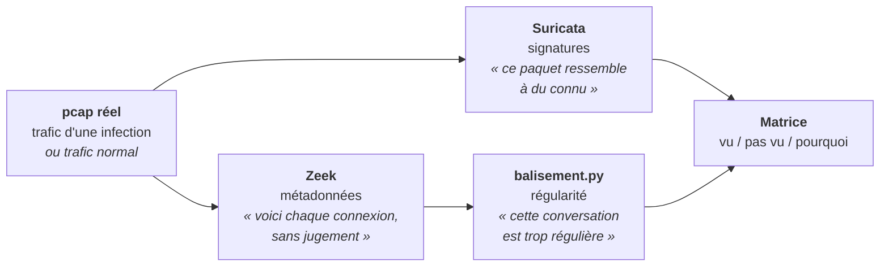

# Module 03 — Le réseau

`Suricata · Zeek · pcaps réels` — détecter un canal de commande et de contrôle (C2) depuis le
fil, là où le capteur poste ne voit rien ou ne voit pas assez.

Les modules 01 et 02 ont construit et éprouvé une détection **sur le poste** : Sysmon produit la
donnée, Sigma écrit la règle, Atomic Red Team prouve qu'elle déclenche. Ce module ajoute la
deuxième moitié de ce que regarde un SOC : **le trafic réseau**.

---

## Pourquoi le réseau

Un attaquant peut renommer un binaire, tuer un agent, effacer un journal Windows. Il ne peut pas
communiquer sans envoyer de paquets. Tout maliciel qui reçoit des ordres ou exfiltre des données
**traverse le réseau**, et le réseau est observé par une machine qu'il ne contrôle pas : la sonde.

| | Capteur poste (Sysmon) | Capteur réseau (Suricata, Zeek) |
|---|---|---|
| Voit | processus, registre, fichiers, accès mémoire | connexions, protocoles, noms, certificats, volumes |
| Ne voit pas | ce qui se passe sur le fil après l'envoi | ce qui se passe dans la machine |
| L'attaquant peut | désactiver l'agent, s'il a les droits | chiffrer, mais pas cacher **qu'il** communique |
| Couvre | les postes instrumentés | tout ce qui passe par le point de capture, instrumenté ou non |

Les deux vues sont complémentaires. Le module 04 les fera converger dans un SIEM ; celui-ci
apprend à lire la seconde.

---

## Le principe du module



On passe **la même capture** aux trois. La comparaison est le résultat :

- **Suricata alerte, Zeek ne montre rien de particulier** : la menace est connue, la signature
  existe, c'est le cas facile.
- **Suricata ne dit rien, le script de balisement remonte la conversation** : la menace est
  inconnue ou chiffrée, mais son **comportement** la trahit. C'est le cas qui justifie Zeek.
- **Personne ne voit rien** : c'est une limite à écrire, pas un échec à cacher.
- **Le script remonte une conversation sur du trafic normal** : c'est un faux positif, et le
  mesurer est la moitié du travail.

---

## Signature contre métadonnée — la notion centrale

**Une signature** décrit un contenu précis : telle chaîne dans telle URI, tel motif d'octets,
tel certificat. Elle est **précise** (peu de faux positifs) et **fragile** : un octet changé, un
chiffrement ajouté, et elle ne voit plus rien. Elle ne détecte que ce que quelqu'un a déjà vu et
décrit.

**Une métadonnée** décrit la forme d'un échange : qui parle à qui, combien de fois, à quel
rythme, avec quel volume, quel nom de domaine, quel certificat. Elle ne dit pas « c'est
malveillant » ; elle permet de remarquer **ce qui ne ressemble pas au reste**. Elle détecte
l'inconnu, au prix de faux positifs à mesurer.

C'est la même leçon que la règle 09 du module 02, transposée au réseau : **reconnaître l'outil
casse dès que l'outil change ; reconnaître le geste inévitable tient plus longtemps.** Un C2 peut
changer de nom de domaine, de chiffrement et de port. Il doit quand même rappeler son serveur.

---

## Les outils, et pourquoi ceux-là

### Suricata — le moteur de signatures

Moteur open source de détection et de prévention d'intrusion (IDS/IPS), maintenu par l'OISF.
C'est la référence du domaine, utilisée dans de nombreuses sondes commerciales. Branche 8 en
cours ; la branche 7 arrive en fin de vie.

**Ce qu'il fait** : il reconstitue les flux, identifie les protocoles (HTTP, TLS, DNS, SMB…)
quel que soit le port, et compare chaque flux à des milliers de règles. Il écrit tout dans un
fichier unique, **`eve.json`** : une ligne JSON par événement.

**Anatomie d'une règle Suricata** :

```
alert http $HOME_NET any -> $EXTERNAL_NET any (msg:"Exemple - User-Agent suspect"; \
    flow:established,to_server; http.user_agent; content:"exemple"; nocase; \
    classtype:trojan-activity; sid:9000001; rev:1;)
```

| Partie | Rôle |
|---|---|
| `alert` | l'action (en IDS : alerter ; en IPS : `drop` possible) |
| `http` | le protocole applicatif — Suricata le reconnaît même sur un port non standard |
| `$HOME_NET any -> $EXTERNAL_NET any` | sens et extrémités du flux |
| `flow:established,to_server` | n'examiner que les flux établis, côté client vers serveur |
| `http.user_agent; content:"…"` | un **tampon** (le champ à examiner) puis le motif à y chercher |
| `sid` / `rev` | identifiant unique et révision — une règle se versionne comme du code |

**Le coût en performance** est une notion à retenir : chaque `content` est une recherche, chaque
`pcre` (expression régulière) l'est beaucoup plus. Une règle se juge aussi à ce qu'elle coûte
sur un lien chargé. Suricata le mesure (`--engine-analysis`, profilage des règles).

**Les règles publiques** : le jeu **ET Open** (Emerging Threats, gratuit) contient plusieurs
dizaines de milliers de règles. L'outil **`suricata-update`** le télécharge et l'assemble.
C'est notre « second avis », comme Hayabusa au module 02 : un jeu maintenu par d'autres, qui
voit ce que nos propres règles ne voient pas encore.

**Le mode pcap** : `suricata -r capture.pcap` analyse un fichier au lieu d'une interface. C'est
ce qu'on fait ici — une capture rejouée donne le même résultat à chaque passage, ce qui rend la
campagne reproductible.

**Les empreintes TLS** : sans déchiffrer, Suricata calcule des empreintes de la négociation TLS
(JA3, JA4, selon la version et la configuration). Un même maliciel produit souvent la même
empreinte quel que soit le serveur contacté. On détecte le client, pas le contenu.

### Zeek — le greffier du réseau

Anciennement Bro. Ce n'est pas un IDS au sens strict : **Zeek ne cherche pas de menace**, il
décrit. Pour chaque connexion, il écrit une ligne dans des journaux structurés, un par protocole.
C'est l'outil qui permet de détecter **ce pour quoi aucune règle n'existe**.

| Journal | Une ligne par… | Champs qui servent ici |
|---|---|---|
| `conn.log` | connexion (TCP, UDP, ICMP) | `ts`, `id.orig_h`, `id.resp_h`, `id.resp_p`, `proto`, `service`, `duration`, `orig_bytes`, `resp_bytes`, `conn_state`, `history` |
| `dns.log` | requête DNS | `query`, `qtype_name`, `rcode_name`, `answers`, `TTLs` |
| `http.log` | requête HTTP | `host`, `uri`, `method`, `user_agent`, `status_code`, `resp_mime_types` |
| `ssl.log` | négociation TLS | `server_name` (SNI), `version`, `cipher`, `validation_status`, empreintes |
| `x509.log` | certificat vu | sujet, émetteur, dates de validité — un certificat auto-signé de 3 jours se remarque |
| `files.log` | fichier transféré | type MIME, taille, empreintes |
| `notice.log` | situation que les scripts Zeek jugent notable | `note`, `msg` |
| `weird.log` | anomalie de protocole | ce que la pile réseau trouve « bizarre » |

Le champ **`uid`** relie toutes ces lignes : la même connexion a le même `uid` dans `conn.log`,
`ssl.log` et `x509.log`. C'est ce qui permet de passer d'une conversation suspecte au certificat
qu'elle a présenté.

Zeek se programme (langage de script Zeek) et s'étend par paquets. Ici, on s'en sert surtout
comme **producteur de données** : ses journaux sont l'entrée du script de balisement.

### `balisement.py` — le script de régularité (écrit pour ce module)

Un implant C2 se réveille, contacte son serveur, demande des ordres, se rendort. Ce **balisement**
(beaconing) laisse une trace que ni le chiffrement ni le changement de domaine n'effacent :

| Indice | Ce qu'on mesure | Ce qui trahit un C2 |
|---|---|---|
| **Régularité d'intervalle** | dispersion des écarts entre connexions successives d'une même paire | des écarts presque identiques (60 s, 60 s, 61 s, 60 s…) |
| **Taille constante** | dispersion des volumes échangés par connexion | « rien de nouveau ? — non » : toujours le même nombre d'octets |
| **Persistance** | part de la période où la paire a parlé | présent du début à la fin, sans trou |
| **Destination inédite** | la destination existe-t-elle dans le trafic normal de référence ? | jamais vue avant l'infection |

Le script lit un `conn.log` (format TSV ou JSON), regroupe les connexions par paire
source → destination, et calcule un **score de 0 à 1** à partir de statistiques robustes
(médiane, écart absolu médian, asymétrie de Bowley). Ces statistiques résistent à la **gigue**
(jitter) que les frameworks C2 ajoutent exprès pour casser la régularité. Le détail du calcul est
en tête du script.

**La référence du domaine s'appelle RITA** (Active Countermeasures, open source) : même idée,
même entrée (journaux Zeek), version industrielle. Écrire un script plus simple soi-même est le
moyen de comprendre ce que RITA calcule — et de pouvoir l'expliquer en entretien. Comparer les
deux sur les mêmes pcaps est une étape du plan de test.

### MITRE ATT&CK — ce qu'on cherche à voir

| Technique | Nom | Ce qui la rend visible sur le réseau |
|---|---|---|
| `T1071.001` | Protocole applicatif : web | requêtes HTTP(S) régulières vers un hôte inhabituel |
| `T1071.004` | Protocole applicatif : DNS | volume ou longueur anormale de requêtes DNS |
| `T1573` | Canal chiffré | TLS vers un certificat auto-signé, récent, ou une empreinte connue |
| `T1571` | Port non standard | un protocole reconnu sur un port qui n'est pas le sien |
| `T1568.002` | Algorithme de génération de domaines | rafales de résolutions NXDOMAIN vers des noms aléatoires |
| `T1029` | Transfert planifié | la régularité elle-même |
| `T1041` | Exfiltration par le canal C2 | volume sortant anormal sur une conversation déjà suspecte |

---

## Les données

### Le trafic malveillant : des pcaps réels

On n'exécute **aucun maliciel**. On analyse des captures d'infections réelles, publiées à des fins
pédagogiques par **Malware-Traffic-Analysis.net** (Brad Duncan, analyste et contributeur du SANS
Internet Storm Center). Chaque capture est accompagnée d'un compte rendu : famille de
maliciel, domaines et adresses du C2, chronologie. C'est notre **vérité terrain** — l'équivalent du
marqueur de test du module 02 : on sait ce qui doit être trouvé.

Les archives sont protégées par mot de passe (la convention est donnée sur la page « about » du
site) pour qu'aucun antivirus ni aucun utilisateur ne les ouvre par accident.

### Le trafic normal : la référence

Sans trafic normal, on ne mesure pas de faux positifs. La référence est une capture du trafic
ordinaire de la VM Windows du lab (navigation, mises à jour, télémétrie), sur plusieurs heures.
C'est elle qui répond à la question qui compte : **sur un poste sain, combien d'alertes ?**
Windows Update, la télémétrie et les clients de synchronisation **balisent eux aussi** — le
script devra les distinguer d'un C2, ou documenter qu'il n'y arrive pas.

---

## Garde-fous — à lire avant de télécharger quoi que ce soit

Les pcaps contiennent du trafic de maliciels réels, et parfois les maliciels eux-mêmes
(téléchargements HTTP reconstituables).

| Règle | Détail |
|---|---|
| **Les pcaps restent dans la VM sonde** | Jamais sur l'hôte Windows, jamais dans le dépôt. On versionne la **source**, l'**empreinte SHA-256** et les **résultats**, pas la capture. |
| **On ne rejoue pas un pcap sur une interface réseau** | Lecture de fichier uniquement (`-r`). Pas de `tcpreplay` vers un réseau. |
| **Extraction de fichiers désactivée** | Zeek et Suricata savent reconstituer les fichiers transférés. On ne l'active pas : on n'a pas besoin du binaire pour détecter son téléchargement. |
| **On ne visite aucun domaine ni adresse du C2** | Pas de navigateur, pas de `curl`, pas de résolution DNS vers les indicateurs. Ils restent du texte. |
| **VM isolée pendant l'analyse** | Réseau hôte uniquement (accès SSH depuis l'hôte, aucune route vers Internet ni vers le réseau domestique). |
| **Instantané avant la campagne** | « sonde outillée hors ligne », pris après installation de l'outillage. |

---

## Ce que contient ce dossier

```
03-reseau/
├── README.md                     ce fichier
├── plan-de-test.md               captures retenues, ce qu'on attend, ordre des opérations
├── matrice-couverture.md         le livrable du module — à remplir
├── VERSIONS.md                   versions réelles de l'outillage, à remplir
├── regles/
│   └── local.rules               nos propres règles Suricata
├── scripts/
│   ├── verifier-sonde.sh         les contrôles avant toute analyse
│   ├── analyser-pcap.sh          Suricata + Zeek sur une capture, résumé chiffré
│   └── balisement.py             score de régularité sur un conn.log
├── preuves/                      sources et empreintes des captures (pas les pcaps)
└── rapports/                     sorties d'analyse et rapports par capture
```

---

## Ordre des opérations

**1. Monter la sonde.** VM Ubuntu Server LTS, 4 Go de RAM, 2 processeurs, 30 Go de disque,
OpenSSH. Réseau en NAT le temps de l'installation.

**2. Installer l'outillage** — Suricata depuis les paquets de l'OISF, Zeek depuis ses paquets
officiels, `jq` et Python 3. Commandes exactes dans `plan-de-test.md`. Reporter les versions
dans `VERSIONS.md` **à partir de ce que les binaires affichent**.

**3. Télécharger les règles ET Open et les captures**, encore en NAT. Vérifier chaque empreinte
contre celle publiée. Puis **couper l'accès Internet** (réseau hôte uniquement) et prendre
l'instantané.

**4. Vérifier avant d'analyser**

```bash
./scripts/verifier-sonde.sh
```

**5. Analyser chaque capture**

```bash
./scripts/analyser-pcap.sh ~/pcaps/<capture>.pcap <etiquette>
```

Le script produit dans `rapports/<date>_<etiquette>/` les journaux Zeek, l'`eve.json` de
Suricata, et un `resume.md` : alertes par signature, connexions par service, principales
destinations.

**6. Chercher le balisement**

```bash
python3 scripts/balisement.py rapports/<dossier>/zeek/conn.log --reference <conn.log du trafic normal>
```

**7. Rendre le verdict** — pour chaque capture : qu'est-ce que Suricata a vu, qu'est-ce que Zeek
et le script ont vu, qu'est-ce que personne n'a vu, et pourquoi. Reporter dans
`matrice-couverture.md`.

**8. Mesurer les faux positifs** — même chaîne sur la capture de trafic normal. Chaque alerte et
chaque conversation au-dessus du seuil de score est un faux positif, à expliquer.

**9. Écrire une règle à soi** — à partir d'un indicateur observé dans une capture, une règle dans
`regles/local.rules`, prouvée sur la capture et muette sur le trafic normal.

---

## Le résultat attendu — et pourquoi il ne sera pas parfait

- **Suricata verra les familles connues** : les règles ET Open couvrent la plupart des maliciels
  documentés. Sur une capture récente, il y aura des alertes, souvent nombreuses et redondantes.
- **Le script verra les C2 réguliers**, y compris chiffrés, et ratera ceux qui ajoutent une forte
  gigue ou ne parlent que quelques fois.
- **Le trafic normal produira des conversations régulières** : mises à jour, télémétrie,
  synchronisation. C'est attendu. Le travail consiste à savoir les expliquer et à décider
  quoi exclure, **en chemin complet** — ici, une adresse ou un domaine précis, jamais une plage
  entière par confort.

Un tableau qui dit « Suricata 3 captures sur 3, script 2 sur 3, 4 faux positifs sur 6 heures de
trafic normal, tous expliqués » vaut plus qu'une détection parfaite non mesurée.

---

## Limites assumées

**Pas de déchiffrement.** On voit qu'une conversation TLS existe, son rythme, son certificat ;
pas son contenu. C'est la situation réelle de la plupart des sondes.

**Des captures qui ne sont pas les nôtres.** Elles viennent d'un autre réseau, avec d'autres
adresses. Les résultats valent pour la méthode, pas pour un environnement de production.

**Une référence mono-poste.** Le trafic normal d'une seule VM sous-estime la diversité d'un vrai
réseau : plus de postes, plus de logiciels, plus de balisements légitimes.

**Pas de temps réel.** On lit des fichiers. L'ingestion continue, la corrélation avec les
journaux Sysmon et la latence d'alerte sont l'objet du module 04.

---

## Module suivant

**04 — La plateforme.** Elastic Security reçoit Sysmon (modules 01-02), Suricata et Zeek
(module 03) dans un schéma commun. Les règles Sigma y sont portées avec ce que Chainsaw ne
supportait pas — `cidr`, expressions régulières — et une attaque du module 02 est suivie de bout
en bout, du processus au paquet.

---

*Mamadou Lamine Thiore — Master 2 Cybersécurité, EPSI Lyon — spécialisation Blue Team.*
