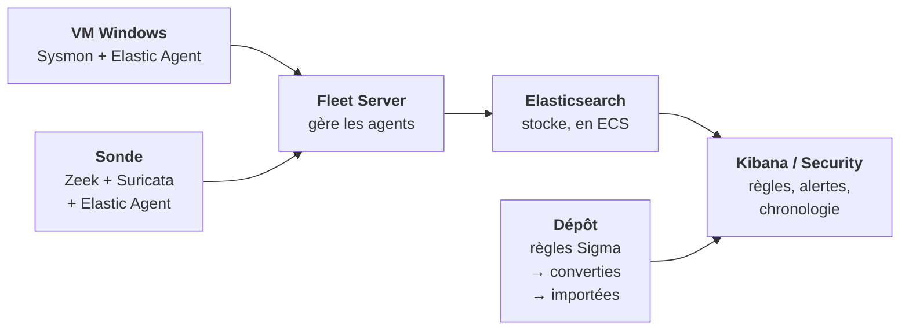
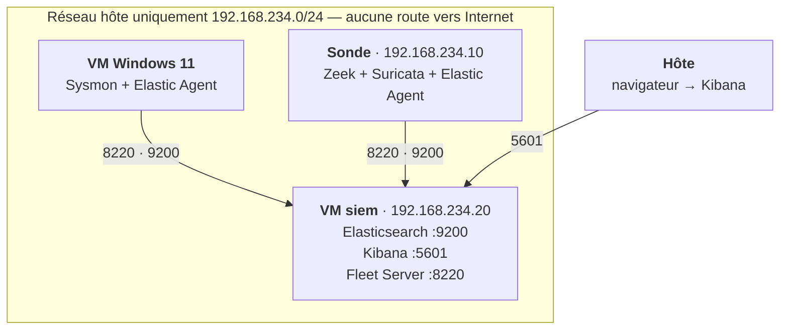

# Module 04 — La plateforme

`Elastic Security 9.5 · Fleet · Elastic Agent · ECS · Sigma · Splunk` — faire converger le poste
et le réseau dans un SIEM, et y gérer la détection comme du code.

Les modules 01 à 03 ont produit trois sources de données, chacune lue à part : les journaux
**Sysmon** du poste Windows (modules 01-02), les journaux **Zeek** et les alertes **Suricata**
de la sonde (module 03). Chaque analyse se faisait avec un outil différent, sur un fichier
différent, dans un format différent. Ce module les réunit **au même endroit, dans le même
schéma, sur la même chronologie** — ce qu'un analyste SOC a devant lui chaque jour.

---

## Pourquoi un SIEM

Jusqu'ici, pour suivre une attaque, il fallait ouvrir un EVTX avec Chainsaw, puis un `conn.log`
avec `zeek-cut`, puis un `eve.json` avec `jq`, et recoller les heures à la main. Un SIEM
(*Security Information and Event Management*) fait trois choses que ces outils ne font pas :

| Besoin | Sans SIEM (modules 01-03) | Avec SIEM (module 04) |
|---|---|---|
| **Centraliser** | un fichier par outil, par machine, par campagne | toutes les sources dans un seul magasin, interrogeables ensemble |
| **Normaliser** | `Image` chez Sysmon, `id.orig_h` chez Zeek, `src_ip` chez Suricata | un seul nom par notion : `process.executable`, `source.ip` |
| **Détecter en continu** | on lance l'analyse quand on y pense | les règles tournent seules, à intervalle fixe, et produisent des alertes |
| **Corréler** | on recolle les heures à la main | une requête relie un processus du poste à une connexion vue par la sonde |

La troisième ligne change le métier : une règle n'est plus un fichier qu'on rejoue sur un EVTX,
c'est un **objet de production** qui tourne, qu'il faut versionner, tester, déployer, et régler
quand il fait du bruit. C'est ce que le module appelle **la détection comme du code**.

---

## Le principe du module



1. Les **agents** collectent sur chaque machine et envoient à Elasticsearch.
2. **Fleet** les pilote depuis Kibana : quelles données, quelle version, quelle politique.
3. Elasticsearch **stocke** dans le schéma commun ECS.
4. Kibana **détecte** (règles), **alerte** et sert à **investiguer** (chronologie, requêtes).
5. Les règles viennent du **dépôt** : écrites en Sigma, converties, importées, versionnées.

---

## Les outils, et pourquoi ceux-là

### Elastic Stack — la plateforme

Suite open source d'Elastic : **Elasticsearch** (moteur de stockage et de recherche),
**Kibana** (interface, et l'application **Security** qui en fait un SIEM), **Elastic Agent**
(collecteur unique sur chaque machine) et **Fleet** (gestion centralisée des agents).

**Pourquoi Elastic plutôt que Wazuh ou Splunk comme plateforme principale** : c'est la seule
plateforme à la fois répandue en production et installable gratuitement en entier, moteur de
détection compris. La licence **Basic** (gratuite, sans limite de durée) inclut le moteur de
règles de Security, plus d'un millier de règles prêtes à l'emploi publiées par Elastic, la chronologie
d'investigation, EQL et ES|QL. Ce qu'elle n'inclut pas — apprentissage automatique, certains
connecteurs — n'est pas nécessaire ici.

**Version retenue : 9.5.5**, la dernière publiée au 15/10/2026. Elle corrige des vulnérabilités
annoncées par Elastic (bulletin du Centre canadien pour la cybersécurité AV26-1021 du
08/10/2026, qui vise Elasticsearch jusqu'à 9.5.5 et Kibana jusqu'à 9.5.4 — on vérifie au
moment de l'installation qu'aucune version plus récente n'est sortie, et on prend la dernière).
**Tous les composants à la même version** : Elasticsearch, Kibana, Fleet Server et les agents
doivent concorder.

### Elasticsearch — le magasin

Base de données orientée documents, distribuée, faite pour chercher vite dans beaucoup de
texte. Chaque événement est un **document JSON** rangé dans un **flux de données** (*data
stream*) dont le nom dit ce qu'il contient :

```
logs-windows.sysmon_operational-default     les événements Sysmon de la VM Windows
logs-zeek.connection-default                le conn.log de Zeek
logs-suricata.eve-default                   l'eve.json de Suricata
```

Le motif est toujours `type-jeu_de_données-espace`. Une recherche sur `logs-*` interroge tout à
la fois ; sur `logs-zeek.*`, seulement Zeek.

**La mémoire** est la contrainte principale : Elasticsearch tourne dans une JVM dont on fixe la
taille du tas (*heap*). Règle d'usage : la moitié de la RAM de la machine, sans dépasser ce que
le reste (Kibana, Fleet Server) laisse libre. Ici, **2 Go de tas sur une VM de 6 Go**.

### Kibana et l'application Security — l'atelier de l'analyste

Interface web d'Elastic. L'application **Security** y ajoute ce qui fait un SIEM :

| Fonction | Ce qu'elle fait | Ce qu'on en fait ici |
|---|---|---|
| **Règles de détection** | requêtes exécutées à intervalle fixe, qui créent une alerte quand elles trouvent | nos 10 règles Sigma portées, plus une sélection de règles Elastic |
| **Alertes** | liste triable, avec statut (ouverte, en cours, close) et gravité | le tableau de bord du triage |
| **Chronologie** (*Timeline*) | enquête : on y glisse des événements, on pivote sur un champ | suivre une attaque du module 02 de bout en bout |
| **Découverte** (*Discover*) | recherche libre dans les données | vérifier qu'une donnée arrive avant d'écrire une règle |
| **Tableaux de bord** | visualisations sur une question | un tableau qui répond à une question opérationnelle précise |

### Les langages de requête

| Langage | Pour quoi | Exemple |
|---|---|---|
| **KQL** (Kibana Query Language) | filtrer vite dans l'interface | `process.name : "vssadmin.exe" and process.args : "delete"` |
| **Lucene** | la syntaxe historique, celle que produit Sigma | `process.name:vssadmin.exe AND process.args:delete` |
| **EQL** (Event Query Language) | **séquences** d'événements ordonnés dans le temps | `sequence by host.name [process where …] [network where …]` |
| **ES\|QL** | requêtes en tuyau, agrégations, calculs | `FROM logs-zeek.* \| WHERE destination.port == 443 \| STATS …` |

**EQL est l'outil de la corrélation** : « ce processus, *puis* dans les 30 secondes cette
connexion, *sur le même hôte* ». C'est ce que ni Chainsaw ni `zeek-cut` ne savaient faire.

### Elastic Agent et Fleet — la collecte

Un seul binaire par machine, qui remplace les anciens Winlogbeat, Filebeat, Packetbeat. On ne le
configure pas sur la machine : on lui attribue dans Kibana une **politique d'agent** (*agent
policy*) qui liste des **intégrations**. Chaque intégration sait lire une source et la traduire
en ECS.

| Intégration | Sur quelle machine | Ce qu'elle lit |
|---|---|---|
| **Windows** | VM Windows | les canaux `Microsoft-Windows-Sysmon/Operational` et PowerShell |
| **System** | VM Windows | les journaux Windows classiques : Sécurité, Système, Application |
| **Zeek** | sonde | les journaux Zeek — **au format JSON** obligatoirement (`LogAscii::use_json=T`) ; le format TSV du module 03 ne convient pas |
| **Suricata** | sonde | `eve.json` |
| **Fleet Server** | VM SIEM | le service qui reçoit les agents (port 8220) |

**Fleet Server** est lui-même un Elastic Agent, avec un rôle particulier : c'est le point de
contact des autres agents. Il tourne sur la VM SIEM.

### ECS — le schéma commun

**Elastic Common Schema** : un dictionnaire de noms de champs partagé par toutes les sources.
C'est ce qui rend la corrélation possible.

| Notion | Sysmon (brut) | Zeek (brut) | Suricata (brut) | **ECS** |
|---|---|---|---|---|
| Adresse source | `SourceIp` | `id.orig_h` | `src_ip` | `source.ip` |
| Adresse destination | `DestinationIp` | `id.resp_h` | `dest_ip` | `destination.ip` |
| Port destination | `DestinationPort` | `id.resp_p` | `dest_port` | `destination.port` |
| Exécutable | `Image` | — | — | `process.executable` |
| Ligne de commande | `CommandLine` | — | — | `process.command_line` |
| Processus parent | `ParentImage` | — | — | `process.parent.executable` |
| Nom de domaine | `QueryName` (événement 22) | `query` | `dns.query.rrname` | `dns.question.name` |
| Agent HTTP | — | `user_agent` | `http.http_user_agent` | `user_agent.original` |

**Une normalisation se vérifie** : une intégration peut mal remplir un champ, ou le laisser dans
son espace d'origine (`winlog.event_data.*`, `zeek.*`). La première étape du module est de
regarder, pour chaque source, ce qui arrive réellement — comme au module 01, où l'on vérifiait
que Sysmon produisait la donnée avant d'écrire la règle.

### Sigma et `sigma-cli` — porter nos règles

Les dix règles du module 01 (dont 09 et 10 en v2, après le module 02) sont écrites en **Sigma**,
format indépendant de tout SIEM. `sigma-cli` et le backend **pySigma-backend-elasticsearch**
(version 2.x) les convertissent :

```bash
sigma convert -t lucene -p ecs_windows -f siem_rule_ndjson 01-socle-windows/sigma/ -o regles/sigma-elastic.ndjson
```

| Option | Rôle |
|---|---|
| `-t lucene` (ou `eql`, `esql`) | le langage cible |
| `-p ecs_windows` | le **pipeline** de correspondance : `Image` devient `process.executable`, etc. |
| `-f siem_rule_ndjson` | la sortie : des règles prêtes à importer dans Kibana Security |

**Le piège du pipeline** : il a été écrit pour Winlogbeat ; l'intégration Windows d'Elastic Agent
range certains champs ailleurs. Une règle convertie sans erreur peut être muette. Chaque règle
portée est donc **rejouée** contre une attaque réelle avant d'être déclarée valide — exactement la
boucle de preuve du module 02, dans le SIEM cette fois.

**Ce que le SIEM débloque** : la règle 07 (LOLBin sortant) utilise le modificateur `cidr`, que
Chainsaw ne supportait pas — elle était « non testable » au module 02. Elasticsearch le gère.

### La détection comme du code

Une règle de production suit le même chemin qu'un logiciel :

```
écrite (Sigma, dans le dépôt)  →  convertie (sigma-cli)  →  testée (rejeu)  →  importée (API Kibana)
     →  versionnée (git)  →  réglée (exceptions documentées)  →  remesurée
```

On n'édite **jamais** une règle à la main dans Kibana sans reporter la modification dans le
dépôt : le dépôt reste la source de vérité. Les importations passent par l'API de Kibana
(`POST /api/detection_engine/rules/_import`), avec une clé d'API dont le secret ne quitte pas le
gestionnaire de mots de passe.

### Splunk — la semaine de fin de module

Le second SIEM le plus demandé dans les offres SOC. **Splunk Enterprise** s'installe en essai de
60 jours (500 Mo d'ingestion par jour), puis passe en licence gratuite. On ne le monte pas en
parallèle d'Elastic : une semaine, à la fin du module, sur le jeu de données **Boss of the SOC**
(BOTS) publié par Splunk, pour apprendre juste assez de **SPL** (*Search Processing Language*)
pour investiguer. Les versions et la taille du jeu de données sont vérifiées à ce moment-là.

---

## Architecture



| VM | RAM | Disque | Rôle |
|---|---|---|---|
| **siem** (nouvelle) | **6 Go** | 60 Go, alloué à la demande | Elasticsearch (tas 2 Go), Kibana, Fleet Server |
| Windows 11 du lab | **4 Go** pendant ce module | existant | source poste |
| sonde | **2 Go** pendant ce module | existant | source réseau |

**L'hôte a 16 Go de RAM** : on ne fait **jamais tourner les trois VM ensemble**. Phase poste :
siem + Windows (10 Go). Phase réseau : siem + sonde (8 Go). Il reste ainsi 6 à 8 Go à Windows
hôte.

**Le disque de l'hôte** a déjà fait tomber une VM au module 03 (écran bleu 0x124). Avant de créer
la VM siem : **au moins 60 Go libres**, obtenus en retirant la VM `srv-wazuh` (44 Go), qui fait
doublon avec Elastic.

---

## Garde-fous

| Règle | Détail |
|---|---|
| **Le SIEM n'a pas d'accès Internet en service** | NAT seulement le temps d'installer les paquets, les intégrations et les règles Elastic (ils viennent du dépôt de paquets d'Elastic), puis réseau hôte uniquement. |
| **Aucun secret dans le dépôt** | Mot de passe `elastic`, jetons d'inscription, clés d'API : dans le gestionnaire de mots de passe, jamais dans un fichier versionné, jamais collés dans une console partagée ou une capture d'écran. Les scripts lisent la clé dans une variable d'environnement. |
| **Un compte par usage** | Le superutilisateur `elastic` sert à l'installation, puis on travaille avec un compte nominatif et des clés d'API à droits limités. |
| **TLS gardé** | Elasticsearch 9 active TLS et l'authentification à l'installation. On ne les désactive pas « pour aller plus vite ». |
| **Le trafic normal reste privé** | Les journaux de la VM Windows dans le SIEM contiennent sa navigation : aucun export brut dans le dépôt, comme au module 03. |
| **Les règles se testent avant d'alerter** | Une règle importée commence **désactivée** ; elle n'est activée qu'après rejeu et mesure du bruit. |
| **Pas de maliciel réel** | Les attaques rejouées sont celles d'Atomic Red Team (module 02) dans la VM isolée ; les données réseau viennent des pcaps du module 03, relus dans la sonde. |

---

## Ce que contient ce dossier

```
04-siem/
├── README.md                    ce fichier
├── plan-de-test.md              les phases, les commandes, ce qu'on attend
├── matrice-couverture.md        le livrable : règle → donnée dans le SIEM → alerte → statut
├── VERSIONS.md                  versions réellement installées, à remplir
├── regles/
│   ├── README.md                conversion Sigma → Elastic, et ce qui se perd en route
│   └── (sorties ndjson générées, versionnées)
├── scripts/
│   ├── verifier-siem.sh         santé d'Elasticsearch, Kibana, Fleet, agents, flux de données
│   └── convertir-sigma.sh       conversion des règles du module 01 vers Elastic
├── preuves/                     relevés horodatés (pas de données brutes)
└── tableaux-de-bord/            exports des tableaux de bord Kibana
```

---

## Ordre des opérations

1. **Libérer le disque** de l'hôte et créer la VM siem (Ubuntu Server 26.04, 6 Go, 60 Go).
2. **Installer** Elasticsearch puis Kibana 9.5.x depuis le dépôt de paquets d'Elastic ; noter
   les versions ; mettre les mots de passe dans le gestionnaire.
3. **Fleet** : installer Fleet Server, puis les intégrations Windows, Zeek et Suricata, et les
   règles prêtes à l'emploi d'Elastic — encore en NAT.
4. **Basculer en réseau hôte uniquement**, adresse fixe `192.168.234.20`, puis
   `./scripts/verifier-siem.sh`.
5. **Source poste** : Elastic Agent sur la VM Windows ; vérifier qu'un événement Sysmon arrive,
   **et dans quels champs**.
6. **Source réseau** : Zeek relancé en JSON sur les pcaps du module 03, Suricata sur les mêmes ;
   Elastic Agent sur la sonde ; vérifier les champs ECS.
7. **Porter les règles** : conversion Sigma, import désactivé, rejeu d'Atomic Red Team, mesure,
   activation.
8. **Corréler** : une requête EQL qui suit une attaque du poste au réseau.
9. **Régler** : chaque alerte bruyante est expliquée, puis réduite par une exception documentée.
10. **Tableau de bord** : une question opérationnelle, une réponse.
11. **Splunk** : une semaine d'investigation sur Boss of the SOC.

---

## Le résultat attendu — et pourquoi il ne sera pas parfait

- **Des règles converties sans erreur qui ne voient rien** : le pipeline de champs n'est pas
  celui de l'agent. C'est le cas le plus instructif — la même leçon qu'au module 01 (« la donnée
  avant la règle »), au niveau du SIEM. La première conversion, faite avant tout test, l'annonce
  déjà : neuf règles sur dix visent un sous-champ `.caseless` dont il faudra vérifier l'existence
  dans les données de l'agent (`regles/README.md`).
- **Des règles Elastic prêtes à l'emploi qui voient ce que les nôtres ratent**, et l'inverse.
  Comparer les deux est un résultat.
- **Du bruit au démarrage** : un SIEM neuf avec des règles activées sans réglage alerte sur tout.
  Le mesurer et le réduire fait partie du livrable.
- **Une corrélation poste-réseau limitée** : la sonde du module 03 lit des captures publiques, pas
  le trafic de la VM Windows. La corrélation poste → réseau sur une même attaque demande que la
  sonde écoute le réseau de la VM, ce que le plan de test vérifie avant de le promettre.

---

## Limites assumées

**Un seul nœud Elasticsearch.** Pas de réplication, pas de haute disponibilité : un SIEM de
laboratoire, pas de production.

**Peu de mémoire.** 6 Go pour toute la pile : les requêtes lourdes seront lentes, et c'est une
contrainte réelle de dimensionnement à documenter, pas à cacher.

**Des données historiques pour le réseau.** Les pcaps datent de janvier à octobre 2026 ; ils
arrivent dans le SIEM avec leurs dates d'origine, pas en temps réel.

---

## Module suivant

**05 — L'annuaire.** GOAD, un Active Directory volontairement vulnérable, envoie ses journaux à
ce SIEM ; BloodHound et PingCastle disent où il est faible ; on attaque, et la matrice dit ce que
le SIEM a vu.

---

*Mamadou Lamine Thiore — Master 2 Cybersécurité, EPSI Lyon — spécialisation Blue Team.*
